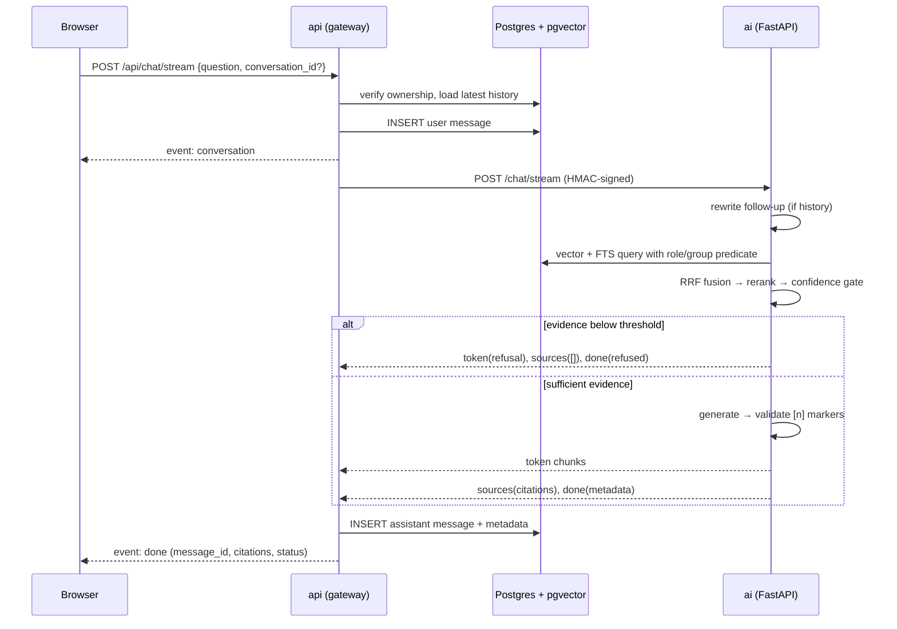

# Verity Architecture

**Status:** Phase 0–3 are implemented and covered by the Node and Python test
suites. Phase 4 (text-to-SQL) is next. Docker Compose cold-start verification and
a measured time-to-first-token run remain Phase 7 items. This document describes
the current shape; behavioral source of truth: [`../plan.md`](../plan.md),
ingestion details: [`ingestion.md`](./ingestion.md), retrieval/chat details:
[`retrieval.md`](./retrieval.md).

## Services

```text
Browser
  │  HTTPS / SSE
  ▼
web (React 18 + Vite build, nginx)
  │  /api
  ▼
api (Express + TypeScript, gateway)
  ├── Postgres 16 + pgvector   app schema (documents, chunks, users, groups, conversations, messages)
  ├── Redis 7                  queues, caches, rate-limit state
  ├── MinIO                    original uploaded documents
  └── ai (FastAPI, internal)   parsing, chunking, embeddings, hybrid retrieval, generation
        ▲
        │ signed /ingest, /documents/{id}, /chat/stream
        │
worker (Node process) ────────┘
  └── BullMQ consumer on Redis
```

The browser never talks to Postgres, Redis, MinIO, or the AI service directly.
The AI service is internal-only; the gateway owns authentication, authorization,
uploads, SSE, and the public API. Text-to-SQL execution will use a separate
`verity_sql_ro` connection that can only read vetted `business_ro` views.

## Authentication and sessions

The gateway issues a short-lived access JWT (in-memory in the browser) and a
rotating refresh token in an `HttpOnly` cookie scoped to `/api/auth`. The refresh
token's SHA-256 hash is stored in `app.refresh_tokens`; the raw token is never
persisted. Every refresh revokes the presented token and links it to its
replacement. Presenting a revoked/replaced token is treated as reuse: all active
sessions for that user are revoked and `refresh_reuse` is written to
`app.auth_audit`.

Authorization happens twice: the React router hides disallowed routes and the
API re-checks the JWT role on every protected request. Roles are `admin`,
`analyst`, and `viewer`; only `admin` can list users, patch roles, or read groups.
The web client performs a silent refresh on load and retries one protected
request after a `401`.

## Document ingestion

Uploads flow `browser → gateway → MinIO → BullMQ → worker → AI → Postgres`.
The gateway validates extension/MIME/size, stores the object, inserts a `queued`
row plus any group grants, and enqueues a job. The worker transitions the row to
`processing`, presigns a short-lived internal URL, and calls the AI service with
an HMAC-signed request. The AI service parses, chunks, and embeds, then replaces
the document's chunks in one transaction. The worker records `ready` with chunk
and page counts. Failures are retried with exponential backoff and finally stored
as `failed` with an actionable `error_code`.

The web app polls the list while anything is `queued` or `processing`. Access is
enforced in the list query and re-checked for detail/download. Downloads use
presigned URLs against `MINIO_PUBLIC_ENDPOINT` so the host browser never needs the
Docker-internal MinIO hostname. Full details: [`ingestion.md`](./ingestion.md).

## Retrieval and chat

Chat flows `browser → gateway → AI → Postgres → AI → gateway → browser`. The
gateway authenticates the request, checks conversation ownership, loads the latest
20 turns, persists the user turn, and forwards the question with the caller's role
and group memberships over a signed internal request. The AI service rewrites
follow-ups, runs access-filtered vector and full-text retrieval, fuses the two
rankings with Reciprocal Rank Fusion, reranks the shortlist, and applies the
confidence gate. Weak evidence short-circuits to a refusal; otherwise the answer
is generated with inline `[n]` citations, validated against the retrieved
passages, and streamed back.



The gateway is the only writer of conversations and messages. It relays
`status`, `route`, `token`, `sources`, and `error` from the AI service, consumes
the upstream `done`, and emits its own `done` after persistence so the client sees
exactly one terminal event. A `conversation` event is sent before generation
starts, which lets the browser stop or regenerate a first turn. While the upstream
request is open the gateway sends a `: ping` heartbeat every 15 seconds.

If the browser disconnects, Express aborts the in-flight request, the gateway
cancels the upstream reader, and any partial answer is stored with
`metadata.answer_status = "aborted"`. Generation failures store partial text as
`error` and emit an in-band SSE error. Regeneration reuses the latest user
message, removes the previous assistant answer when it is the last message, and
does not add a duplicate user turn. History queries take the newest 20 messages
and then re-sort them chronologically, so long conversations keep recent context.

Access filtering happens inside both retrieval SQL arms. Admin sees everything;
analysts see public and internal documents plus restricted documents granted to
their groups; viewers see public documents plus explicitly granted restricted
documents. No post-filtering is used. The pipeline and configuration are documented
in [`retrieval.md`](./retrieval.md).

## Current components

| Component         | Current state                                                                                                                                                                                                                                                                                  |
| ----------------- | ---------------------------------------------------------------------------------------------------------------------------------------------------------------------------------------------------------------------------------------------------------------------------------------------- |
| `apps/web`        | Token-based design system, primitives, auth context/silent refresh, router guards, login, shell, documents library with multi-upload/filters/polling/detail editor, grounded chat with streaming, stop/retry/regenerate/copy, citation chips, evidence drawer, feedback, and conversation rail |
| `apps/api`        | Express gateway with health, auth routes, RBAC middleware, refresh rotation/reuse detection, audit events, document APIs, upload validation, signed AI client, conversations/messages, SSE relay with heartbeat and abort persistence, chat rate limiting, tests                               |
| `apps/api` worker | Dedicated BullMQ consumer: status transitions, retries/backoff, chunk/page bookkeeping, ingestion audit trail                                                                                                                                                                                  |
| `services/ai`     | FastAPI `/health`, signed `/ingest`, `DELETE /documents/{id}`, signed `/chat/stream`, parsing, chunking, batched embeddings, hybrid retrieval, RRF, reranking, confidence gate, citation validation, query rewriting                                                                           |
| Postgres          | pgvector, `app` / `business` / `business_ro` schemas, versioned migrations including users/groups/refresh tokens/documents/chunks/ingestion jobs/conversations/messages/feedback                                                                                                               |
| Roles             | `verity_app` (DML on `app`) and `verity_sql_ro` (SELECT on `business_ro`)                                                                                                                                                                                                                      |
| Redis             | BullMQ ingestion queue, rate-limit state, embedding cache                                                                                                                                                                                                                                      |
| MinIO             | Private bucket bootstrapped by `minio-init`; original documents; separate internal/public presigned URL endpoints                                                                                                                                                                              |
| Web / API         | Static build served by nginx, `/api` proxy with SSE buffering disabled                                                                                                                                                                                                                         |
| Langfuse          | Deferred to Phase 6 (plan §16); not faked                                                                                                                                                                                                                                                      |

## Database roles

The official Postgres image needs a superuser to initialize the cluster. Using
`verity_app` as that superuser would silently violate the least-privilege
requirement in `plan.md`, so Phase 0 separates them:

| Role                              | Purpose                | Privileges                                                                       |
| --------------------------------- | ---------------------- | -------------------------------------------------------------------------------- |
| `postgres` (`POSTGRES_SUPERUSER`) | init + migrations only | superuser, never used by app traffic                                             |
| `verity_app`                      | API and AI ingestion   | CONNECT, USAGE on `app`, DML on `app` tables/sequences                           |
| `verity_sql_ro`                   | text-to-SQL execution  | CONNECT, USAGE on `business_ro`, SELECT only, 5s timeout, read-only transactions |

`make verify-roles` proves both the positive grants and the negative boundaries
(no app-schema access for the SQL role, no DDL, no `pg_sleep`).

## Startup order

`postgres`, `redis`, and `minio` become healthy → `migrate` records/applies SQL
migrations and `minio-init` creates the private bucket → `ai` starts and becomes
healthy → `api` and `worker` start → `web` starts after the API is healthy. Demo
users and the document corpus are created separately with `make seed` (host Node
against the exposed Postgres port and Redis).

## Planned boundaries

- **Phase 1 (implemented):** auth (JWT + rotating refresh cookie), RBAC, app schema tables, design system, app shell.
- **Phase 2 (implemented):** upload → MinIO → queue → parse → chunk → embed → ready, BullMQ worker, document library UI, access grants, demo corpus.
- **Phase 3 (implemented):** query rewrite, access-filtered hybrid retrieval, RRF, rerank, confidence gate, citations, SSE chat with stop/retry/regenerate, feedback. Live time-to-first-token measurement remains deferred.
- **Phase 4:** `business` seed data, `business_ro` views, sqlglot validation, read-only execution, SQL UI.
- **Phase 5:** router, hybrid answers, conversation memory.
- **Phase 6:** Langfuse, RAGAS eval harness, metrics, feedback.
- **Phase 7:** hardening, load tests, accessibility, final docs and Compose cold start.

## Non-goals

No multi-warehouse connectors, global search, cryptographic attestation,
fabricated scan counts, or manual route selector. These appear in the
supplementary design spec but are not backed by `plan.md`; see C1–C12 in
[`implementation-plan.md`](./implementation-plan.md).
