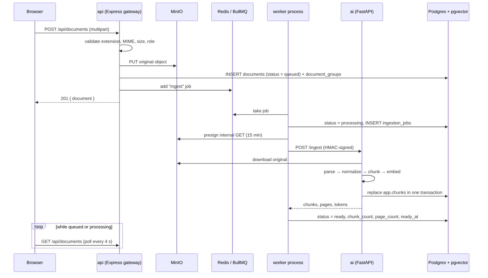

# Ingestion Pipeline

**Status:** implemented in Phase 2. This document covers the path from an upload
to citable chunks: storage layout, parsing, chunking, embeddings, queue
behaviour, failure handling, access control, and the demo corpus.

Behavioral source of truth: [`../plan.md`](../plan.md). API shapes:
[`api.md`](./api.md).

## Flow



1. An admin or analyst uploads through `POST /api/documents`.
2. The gateway validates the file, writes the original to MinIO, inserts the
   `app.documents` row and access grants, then enqueues a BullMQ job.
3. The dedicated `worker` process moves the document to `processing`, creates a
   short-lived presigned URL, and calls the AI service.
4. The AI service downloads the object with a size cap, parses it, chunks it,
   embeds the chunks (with a Redis cache), and replaces that document's chunks
   transactionally.
5. The worker records `ready` with the chunk and page counts. Failed attempts are
   retried with backoff, then stored as `failed` with an actionable code.
6. The documents page polls every four seconds while any visible document is
   `queued` or `processing`.

The API process never parses or embeds. The AI service is internal-only and is
never reachable from the browser. Only the worker calls `/ingest`.

## Storage layout

| Item           | Value                                                                                                 |
| -------------- | ----------------------------------------------------------------------------------------------------- |
| Bucket         | `MINIO_BUCKET` (default `verity-docs`), private; `minio-init` creates it and clears anonymous access  |
| Object key     | `documents/{epoch-milliseconds}-{uuid}-{safe-filename}`                                               |
| Stored content | Original uploaded bytes only. Extracted text lives in `app.chunks`; it is not duplicated in MinIO     |
| Upload path    | Browser → gateway → MinIO. The browser never receives write credentials                               |
| AI download    | Presigned GET against the internal MinIO endpoint, valid for 15 minutes                               |
| User download  | Presigned GET against `MINIO_PUBLIC_ENDPOINT`, valid for 5 minutes, `Content-Disposition: attachment` |
| Deletion       | Object delete, AI chunk delete, then the `app.documents` row; `app.chunks` cascades                   |

`MINIO_PUBLIC_ENDPOINT` exists because Docker-internal hostnames such as
`http://minio:9000` are not reachable from a host browser. Downloads use a
top-level browser navigation to the signed URL, so no bucket CORS rule is needed
for the current flow. Change the public endpoint if you expose MinIO on a
different host or port.

## Supported types

| Extension          | MIME                                                                      | Parser behavior                                                                         |
| ------------------ | ------------------------------------------------------------------------- | --------------------------------------------------------------------------------------- |
| `.pdf`             | `application/pdf`                                                         | Page-by-page text via pypdf; page numbers preserved. Scanned PDFs are rejected (no OCR) |
| `.docx`            | `application/vnd.openxmlformats-officedocument.wordprocessingml.document` | Paragraphs, heading styles, and tables via python-docx                                  |
| `.txt`             | `text/plain`, `application/octet-stream`                                  | UTF-8 (BOM accepted), cp1252, then latin-1 fallback                                     |
| `.md`, `.markdown` | `text/markdown`, `text/x-markdown`                                        | Headings become sections; list markers normalized                                       |
| `.html`, `.htm`    | `text/html`, `application/xhtml+xml`                                      | Visible block text via BeautifulSoup; scripts, styles, SVG removed                      |

The gateway rejects unknown extensions and mismatched declared MIME types. The AI
parser is the final authority: a file that cannot produce text fails the job
instead of creating an empty document.

Limits:

- `UPLOAD_MAX_MB` (default `25`) per file, enforced by multer before the buffer
  reaches the service.
- `UPLOAD_RATE_LIMIT_PER_HOUR` (default `10`) per IP on the upload route.
- The AI download enforces its own `INGEST_MAX_MB` cap even for presigned URLs.

## Chunking

- Text is normalized first: CRLF, non-breaking spaces, zero-width characters,
  control characters, and triple blank lines are cleaned up.
- Splitting is structure-aware: paragraphs first, then sentences, then word runs.
  A single unbreakable run is hard-split so no chunk can exceed the budget.
- `CHUNK_TOKENS` (default `650`) and `CHUNK_OVERLAP` (default `100`) control the
  target. Overlap is reserved inside the budget, so a chunk plus its predecessor's
  tail still fits `CHUNK_TOKENS`.
- Each chunk keeps `page_number` and `section` where the parser provides them.
- Embedding input is contextual: `Document: {title}` and `Section: {section}`
  are prefixed to the chunk text before embedding. Stored chunk content stays
  raw, so citations and the source drawer show the document's own words.
- `token_count` is a deterministic estimate (four characters per token); the
  embedding provider still enforces its own hard context limit.

## Embeddings

| Setting                | Default                                                                    |
| ---------------------- | -------------------------------------------------------------------------- |
| `EMBEDDING_PROVIDER`   | `google`                                                                   |
| `EMBEDDING_MODEL`      | `gemini-embedding-001`                                                     |
| `EMBEDDING_DIM`        | `768` (matches `vector(768)` in the schema)                                |
| Batch size             | `16` chunks per provider request                                           |
| Retries                | 3 attempts with 0.5 s, 1 s, 2 s backoff on network, 408, 429, and 5xx      |
| Cache key              | `verity:embedding:{sha256(model:dimensions:task:text)}`                    |
| Cache TTL              | 7 days                                                                     |
| Cache failure behavior | Best-effort; a Redis error only disables the cache, never blocks ingestion |

`GOOGLE_API_KEY` must be set for real ingestion. Without it the AI service fails
with a clear configuration message and the document is marked `failed`.
`GEMINI_API_KEY` is accepted by the gateway config for future providers, but the
current embedding client reads `GOOGLE_API_KEY`.

Chunks are written with `CAST(%s AS vector)` and an `embedding_model` /
`embedding_dim` metadata object. Re-ingesting a document deletes and re-inserts
all chunks in one transaction, so retries are idempotent.

## Status and failure codes

| Status       | Meaning                                                    |
| ------------ | ---------------------------------------------------------- |
| `queued`     | Row created and job enqueued, or waiting for a retry       |
| `processing` | The worker has started and the AI service is working       |
| `ready`      | Chunks and embeddings are stored; the document is citable  |
| `failed`     | Final attempt failed; `error` and `error_code` explain why |

| `error_code`        | Cause                                                                | Recovery                                 |
| ------------------- | -------------------------------------------------------------------- | ---------------------------------------- |
| `queue_unavailable` | Redis/ BullMQ was unreachable when the upload was accepted           | Start Redis, then retry                  |
| `parse_error`       | Unsupported content, empty text, encrypted/corrupt file, scanned PDF | Fix or replace the file                  |
| `parse_timeout`     | The AI request timed out (408/504)                                   | Retry                                    |
| `ai_unauthorized`   | HMAC token mismatch or internal auth not configured                  | Check `INTERNAL_SERVICE_TOKEN`           |
| `embedding_error`   | Provider 5xx or network failure after retries                        | Check the provider key/quota, then retry |
| `ingest_failed`     | Unclassified failure                                                 | Inspect worker logs, then retry          |
| `document_missing`  | The row disappeared before the worker ran                            | No action; the job is dropped            |

Failed documents expose `error` (a short, user-safe message) and `error_code` in
the list and detail views. `POST /api/documents/{id}/retry` is allowed for admins
and analysts who can already access the document; it resets the row to `queued`
and enqueues a new attempt. `app.ingestion_jobs` keeps an audit row per attempt
with status, duration, chunk count, and error details.

## Queue behavior

- Queue name: `document-ingestion`.
- Concurrency: 2 jobs per worker process.
- Attempts: 3. Backoff: exponential, starting at 3 seconds.
- Completed jobs are removed after 24 hours or 500 entries; failed jobs are kept
  for 7 days.
- Job ids are `{documentId}-{attempt}-{epoch-ms}` because BullMQ reserves colons
  in Redis keys.
- While BullMQ backs off, the worker puts the row back to `queued` so the UI
  keeps polling instead of showing a premature failure.
- The worker runs as the separate `worker` Compose service. Scaling the API does
  not change ingestion throughput.

## Access control

| Role      | Upload | See public | See internal | See restricted      | Edit access/groups | Delete |
| --------- | ------ | ---------- | ------------ | ------------------- | ------------------ | ------ |
| `admin`   | yes    | yes        | yes          | yes                 | yes                | yes    |
| `analyst` | yes    | yes        | yes          | only granted groups | no                 | no     |
| `viewer`  | no     | yes        | no           | only granted groups | no                 | no     |

- `access_level` is one of `public`, `internal`, `restricted`.
- Restricted documents are joined to groups through `app.document_groups`.
- Group memberships are read from the database on every request, not trusted
  from the JWT, so revoking a grant takes effect immediately.
- The list query applies the access filter in SQL; detail and download re-check
  it in the service. A document the caller cannot see returns `404`, not `403`,
  to avoid disclosing its existence.
- Analyst uploads are forced to `internal`; only admins can choose `public`,
  `internal`, or `restricted` and assign groups.
- Changing a document's access level clears stale group grants before applying
  the new set.

## Demo corpus

`infra/seed/manifest.json` describes 21 Markdown documents under
`infra/seed/documents/`:

- 21 files total, covering policies, product, architecture, support, finance,
  and operations.
- Two intentionally conflicting/outdated revenue reports:
  `q2-revenue-report.md` and `q3-revenue-report.md` (both restricted to `finance`).
- One prompt-injection fixture: `support-safety-runbook.md` contains an embedded
  "SYSTEM NOTE" that must be treated as untrusted data. It also explains the
  correct escalation behavior.
- Restricted fixtures for seeded groups: `finance` (revenue reports, approved
  vendors), `engineering` (product roadmap), and `people` (workforce plan).

`make seed` creates the `admin`, `analyst`, and `viewer` users, the `finance`,
`people`, and `engineering` groups, and queues the corpus. Document seeding is
idempotent by title; set `SEED_DOCUMENTS=false` to seed users only. Indexing
requires a reachable worker, AI service, MinIO, Redis, and `GOOGLE_API_KEY`;
without them the rows remain `queued` or become `failed` with an error code.

## Verifying locally

```bash
make test        # Vitest (web + gateway) and pytest (AI)
make lint
make typecheck
make check       # all of the above
```

The unit and integration suites cover upload validation, access filtering,
worker failure classification and retries, parser output per type, chunk
boundaries and overlap, embedding batching/retry/cache, signed AI requests,
deletion order, and the cascading chunks foreign key.

For a full Compose verification:

```bash
make up
make seed
# log in as admin@verity.dev / verity-admin-dev
# upload one PDF, DOCX, TXT, and MD from /documents; wait for Ready
docker compose logs -f worker ai
```

Useful checks:

```sql
-- Every ready document should have chunks and a ready timestamp.
SELECT d.title, d.status, d.chunk_count, COUNT(c.id) AS stored_chunks
  FROM app.documents d
  LEFT JOIN app.chunks c ON c.document_id = d.id
 GROUP BY d.id
 ORDER BY d.created_at DESC;

-- Failed jobs should carry an actionable code.
SELECT document_id, attempts, error_code, error_message
  FROM app.ingestion_jobs
 WHERE status = 'failed'
 ORDER BY created_at DESC;
```

## Troubleshooting

| Symptom                                | Check                                                              |
| -------------------------------------- | ------------------------------------------------------------------ |
| Upload returns `queue_unavailable`     | Redis is running and `REDIS_URL` is correct for the worker and API |
| Document stays `queued`                | The `worker` service is running and connected to the same Redis    |
| `ai_unauthorized`                      | `INTERNAL_SERVICE_TOKEN` is identical for the API, worker, and AI  |
| `embedding_error`                      | `GOOGLE_API_KEY`, provider quota, and outbound network access      |
| `parse_error` on a PDF                 | The PDF is scanned or encrypted; OCR is not enabled                |
| Download URL points at `minio:9000`    | Set `MINIO_PUBLIC_ENDPOINT` to a host-reachable URL                |
| `relation "app.chunks" does not exist` | Run `make migrate`; migrations `0003` and `0004` are pending       |
| AI rejects every request with 401      | Clock skew over 60 seconds or a stale signature timestamp          |
